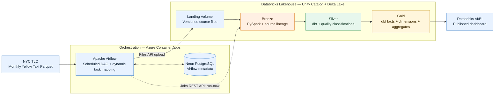
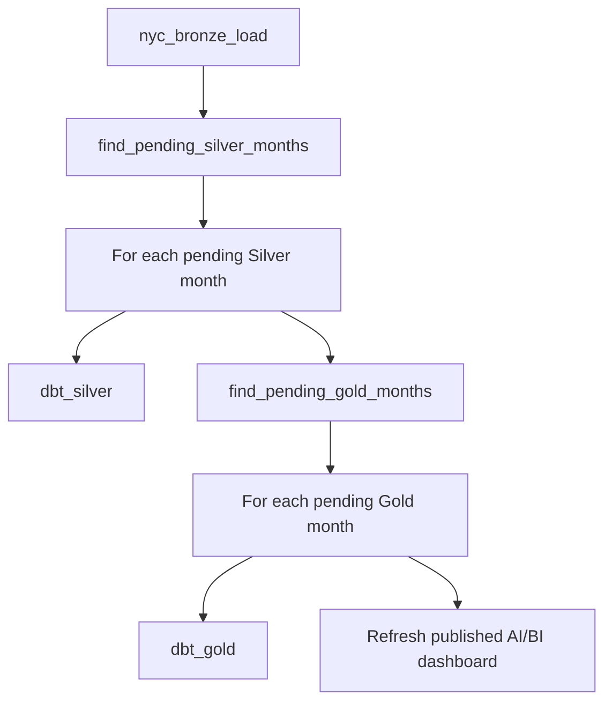

<div align="center">

# 🚕 NYC Yellow Taxi — End-to-End Data Engineering Pipeline

### Incremental ingestion · Medallion lakehouse · Data quality · Dimensional modeling · Cloud orchestration · Analytics

**Apache Airflow · Azure Container Apps · Docker · Python · Databricks · PySpark · Delta Lake · Unity Catalog · dbt · SQL · Neon PostgreSQL**

[](https://www.python.org/)
[](https://airflow.apache.org/)
[](https://www.databricks.com/)
[](https://www.getdbt.com/)
[](https://azure.microsoft.com/products/container-apps)

[**Architecture**](#architecture) · [**Pipeline**](#pipeline-walkthrough) · [**Data Quality**](#data-quality) · [**Results**](#results) · [**Run Locally**](#run-locally) · [**Cloud Deployment**](#cloud-deployment) · [**Lessons Learned**](#engineering-decisions--lessons-learned)

</div>

---

## Overview

The [New York City Taxi & Limousine Commission (TLC)](https://www.nyc.gov/site/tlc/about/tlc-trip-record-data.page) publishes millions of taxi-trip records as monthly Parquet files. Turning those files into trustworthy analytics requires more than downloading data: source files can be revised, historical months must not be loaded twice, quality issues must be visible, and downstream models should update only when necessary.

This project implements a **cloud-orchestrated batch data platform** that:

- Discovers and version-checks monthly NYC Yellow Taxi Parquet files.
- Uploads new/changed files into a **versioned Unity Catalog Volume**.
- Processes data through **Bronze → Silver → Gold** Delta Lake layers.
- Applies data-quality classifications and automated dbt tests.
- Builds **trip-level facts, conformed dimensions, and analytics aggregates**.
- Refreshes a published **Databricks AI/BI dashboard**.
- Runs Apache Airflow on **Azure Container Apps** using a Docker image and **Neon PostgreSQL** for Airflow metadata.

> **Project status:** A cloud-hosted Airflow DAG successfully completed the no-new-file path and triggered a successful Databricks Bronze → Silver → Gold → dashboard workflow. A fresh-file ingestion from the Azure deployment is still to be validated. This is a working portfolio/learning deployment, **not a claim of production SLA or guaranteed zero-cost hosting**.

## Results

**Snapshot: January–September 2026 Yellow Taxi data**

| Metric | Result |
|:--|--:|
| Raw trips in Bronze | **33,579,399** |
| Trips classified as `VALID` | **23,659,334** |
| Gold fact rows (`fact_taxi_trips`) | **23,659,334** |
| Gold dbt models | **11** |
| Gold first-build checks | **42 successful operations** (11 models + 31 tests) |
| Trip charges reported by dashboard | **$700.12M** |
| Average fare reported by dashboard | **$19.81** |
| Recorded tips reported by dashboard | **$88.30M** |

*The figures are a validated project snapshot, not a live feed. Dashboard monetary metrics retain the meanings used in the Databricks dashboard; they should not be interpreted as audited net revenue.*

## Architecture



**Separation of responsibilities:** Azure hosts the **Airflow application**, not the Databricks Lakehouse. The custom image is published to **Docker Hub**; Airflow metadata lives in **Neon PostgreSQL**; datasets, processing control tables, dbt outputs, workflows, and BI dashboards live in **Databricks**. The repository and dbt source code are version-controlled in **GitHub**.

## Technology Stack

| Technology | Role |
|:--|:--|
| **Python** | Source discovery, version checks, streaming download, SHA-256 verification, Files API upload |
| **Apache Airflow 2.10.5** | Scheduling, task dependencies, dynamic task mapping, retries, Databricks triggering |
| **Docker & Docker Hub** | Reproducible Airflow image and image distribution |
| **Azure Container Apps** | Hosts the cloud Airflow webserver, scheduler, and task execution |
| **Neon PostgreSQL** | Persistent Airflow metadata database |
| **Databricks Workflows** | Coordinates Bronze notebooks, per-month Silver/Gold dbt runs, dashboard refresh |
| **PySpark** | Bronze ingestion into Delta Lake |
| **Delta Lake + Unity Catalog** | Managed tables, source-version tracking, and versioned file landing |
| **dbt + SQL** | Silver quality transformations, Gold dimensional models, assertions/tests |
| **Databricks AI/BI** | Interactive analytics dashboard |
| **GitHub** | Source control and dbt Git integration; **not** the deployed scheduler |

## Pipeline Walkthrough

### 1. Incremental source discovery and ingestion — Airflow

Main DAG: [`dags/nyc_taxi_ingestion.py`](dags/nyc_taxi_ingestion.py)  
Schedule: **`0 6 * * *` (06:00 UTC, daily)**

```text
discover_source_files
        |
        v
filter_new_versions
        |
        v
ingest_month [dynamically mapped over pending months]
        |
        v
trigger_databricks_job
```

**Source-version aware by design:**

1. Discover eligible monthly Yellow Taxi Parquet files from the TLC source. The initial 2026 ingestion logic uses a conservative publication lag to avoid requesting months before they become available.
2. Inspect upstream HTTP `ETag` and `Content-Length` metadata.
3. Compare upstream versions with the Delta control table `nyc_project.default.ingestion_control`.
4. For pending versions, stream-download a file, compute its **SHA-256** checksum, and upload it through the Databricks Files API.
5. Store the file in the Unity Catalog Volume with its source year/month and content-based version.
6. Record successful ingestion, clean local staging files, and trigger the Databricks Job — **including when no new files are found**.

Conceptual landing layout:

```text
/Volumes/nyc_project/default/nyc_landing_layer/
└── yellow/
    └── year=2026/
        └── month=09/
            └── version=<sha256>/
                └── yellow_tripdata_2026-09.parquet
```

The Airflow → Databricks handoff uses the **Jobs REST API**, an idempotency token, and run-status polling. The source-version control table prevents duplicate processing of the same source version.

### 2. Bronze — Raw Delta tables with source lineage

**Notebook:** `nyc_bronze_load`  
**Table:** `nyc_project.bronze.yellow_taxi_trips`  
**Control:** `nyc_project.bronze.bronze_processing_control`

Bronze loads landed Parquet data into a Delta table while preserving traceability through fields such as:

```text
_source_month
_source_version
_source_file
_bronze_ingested_at
```

When a month's source changes, the design can replace **that month only** rather than append duplicate rows or rebuild all history.

### 3. Silver — Quality-aware incremental transformations

Silver dbt staging logic evaluates passenger counts, distances, monetary fields, timestamps, and trip duration. Rows are **classified**, rather than indiscriminately discarded.

**Table:** `nyc_project.silver.silver_yellow_taxi_trips`  
**Control:** `nyc_project.silver.silver_processing_control`

#### Data Quality

| Classification | Rows |
|:--|--:|
| `VALID` | 23,659,334 |
| `INCOMPLETE` | 8,123,854 |
| `REVIEW` | 1,780,579 |
| `SUSPICIOUS` | 15,046 |
| `HIGHLY_SUSPICIOUS` | 564 |
| `INVALID` | 22 |
| **Total** | **33,579,399** |

The `find_pending_silver_months` notebook identifies source months whose Bronze versions have not yet been reflected in Silver. dbt runs for those months, tests the outputs, and records completion only after successful processing.

### 4. Gold — Dimensional models and aggregates

**Fact table:** `nyc_project.gold.fact_taxi_trips` — one row per **VALID** trip.

| Dimensions | Incremental aggregates |
|:--|:--|
| `dim_date` | `agg_daily_trips` |
| `dim_location` | `agg_hourly_demand` |
| `dim_payment_type` | `agg_zone_performance` |
| `dim_vendor` | `agg_payment_analysis` |
| `dim_rate_code` | `agg_data_quality` |

The Gold layer uses **one trip fact, five dimensions, and five aggregates** (11 dbt models). The official taxi-zone reference data is loaded as a **dbt seed** and made available for zone analysis.

**Gold processing control:** `nyc_project.gold.gold_processing_control`

> **Modeling note:** The project uses dimensional modeling and incremental facts/aggregates. The current implementation should **not** be described as having a separate financial-transactions fact, an SCD Type 2 location dimension, or a fully implemented SCD framework unless those models are added later.

### 5. Databricks Workflow — Only process pending months



*The diagram summarizes the nested Databricks For each workflow. Silver and Gold checkpoints are persisted separately; a completed month is not automatically recomputed unless source versions or control state require it.*

### 6. Analytics — Databricks AI/BI

Published dashboard: **NYC Yellow Taxi | Analytics**

The dashboard provides:

- Trip-volume trends and daily/monthly performance.
- Charges, fares, tips, and passenger-count metrics.
- Top pickup zones, vendor mix, and payment-method analysis.
- Day-of-week × hour demand heatmaps.
- Data-quality distributions and monthly valid-trip rates.

Dashboard refresh is the **final task** of the Databricks Job.

## Incremental Processing, Checkpoints & Recovery

| Layer | What determines pending work? | How duplication is avoided |
|:--|:--|:--|
| Landing | Source HTTP metadata and ingestion-control records | Content-versioned storage + checksum tracking |
| Bronze | New landing source version per month | Month-scoped Delta replacement + processing control |
| Silver | Bronze version differs from Silver checkpoint | Month-scoped incremental dbt build + checkpoint after success |
| Gold | Silver version differs from Gold checkpoint | Incremental facts/aggregates + checkpoint after successful validation |

**Recovery validated:** A September checkpoint was intentionally removed in both Silver and Gold tests. The relevant month was identified as pending, reprocessed, checkpointed again, and subsequently reported as up-to-date.

**No-change run validated:** Airflow correctly skipped mapped ingestion when no source file was pending while still triggering the Databricks pipeline and dashboard refresh.

## Repository Structure

```text
nyc-taxi-data-pipeline/
├── dags/
│   ├── nyc_taxi_ingestion.py           # Production-oriented ingestion DAG
│   └── databricks_connectivity_smoke.py # Connection/volume smoke test
├── dbt/
│   └── nyc_taxi/                       # dbt models, tests, macros, seeds
├── docker/
│   └── airflow/
│       ├── Dockerfile                  # Airflow 2.10.5 / Python 3.12
│       ├── requirements.txt            # Databricks provider + SDK
│       └── start-cloud.sh              # Azure startup entrypoint
├── scripts/                            # Local PowerShell helpers
├── docker-compose.yml                  # Local Airflow + PostgreSQL
├── .env.example                        # Placeholder settings ONLY
└── README.md
```

Some Databricks notebooks, Workflows configuration, tables, and the published dashboard live in the **Databricks workspace**, rather than as executable assets directly inside this Git repository.

## Run Locally

### Prerequisites

- Docker Desktop with Linux containers (WSL2 on Windows).
- Access to a Databricks workspace with the required Unity Catalog catalog, schema, and Volume.
- A Databricks access token and a SQL warehouse HTTP path for the ingestion DAG.
- PowerShell to use the repository's convenience scripts.

Clone:

```powershell
git clone https://github.com/aouamimarouan/nyc-taxi-data-pipeline.git
cd nyc-taxi-data-pipeline
```

Prepare the local environment:

```powershell
.\scripts\prepare.ps1
```

Edit the newly created `.env`. Use **your own** credentials; never commit this file. The sample `.env.example` may need additional keys such as `DATABRICKS_HTTP_PATH` and `AIRFLOW_VAR_NYC_BRONZE_JOB_ID` for the full ingestion DAG.

```dotenv
# Examples — NOT real credentials
DATABRICKS_HOST=https://your-workspace.cloud.databricks.com
DATABRICKS_TOKEN=<your-private-token>
DATABRICKS_HTTP_PATH=/sql/1.0/warehouses/<warehouse-id>
DATABRICKS_CATALOG=nyc_project
DATABRICKS_SCHEMA=default
DATABRICKS_VOLUME=nyc_landing_layer
AIRFLOW_ADMIN_USERNAME=admin
AIRFLOW_ADMIN_PASSWORD=<choose-a-strong-local-password>
```

Start the local stack:

```powershell
.\scripts\start.ps1
```

Alternatively, when `.env` has all required Compose settings:

```powershell
docker compose up -d --build
```

Open **http://localhost:8080** and sign in using the Airflow admin credentials in `.env`.

**Initial connectivity check:** Run the paused `databricks_connectivity_smoke` DAG to validate workspace authentication and Unity Catalog Volume access. Then verify the required Databricks Job ID and trigger `nyc_taxi_ingestion` manually.

Useful local commands:

```powershell
.\scripts\status.ps1
.\scripts\stop.ps1
# Inspect container logs
docker compose logs -f airflow-scheduler airflow-webserver
```

> **Reproducibility:** The data-processing notebooks, Databricks Job configuration, and dashboard require corresponding resources in your own workspace. Cloning this repository alone does **not** provision those assets or grant workspace permissions.

## Cloud Deployment

The tested cloud configuration is:

| Component | Deployment |
|:--|:--|
| Airflow | Azure Container Apps (Express, Consumption) |
| Image | [`aouamimarouan/nyc-airflow:azure-v2`](https://hub.docker.com/r/aouamimarouan/nyc-airflow) |
| Container resources | 1 vCPU, 2 GiB RAM; one running replica |
| Executor | `LocalExecutor`, parallelism limited to 1 |
| Airflow metadata | External Neon PostgreSQL |
| Source control | GitHub; dbt tasks use the repository |
| Analytics platform | Databricks Free Edition workspace |
| Web UI | HTTPS ingress to port `8080`, restricted by IP allowlist |

High-level deployment sequence:

1. Build the Docker image from `docker/airflow/Dockerfile`, which packages the DAGs and cloud startup script.
2. Push it to Docker Hub.
3. Provision an Azure Container Apps environment and a persistent PostgreSQL database.
4. Create the Container App and configure its secrets and non-secret environment variables.
5. Set ingress to HTTP on container port `8080`, with HTTPS externally, and restrict client access using a **CIDR allow rule** (for example, `YOUR_PUBLIC_IP/32`).
6. Confirm `/health` reports healthy Airflow metadata database and scheduler, then execute a manual DAG run.

Build and publish an updated image:

```powershell
docker build -f docker/airflow/Dockerfile -t nyc-airflow:azure-v2 .
docker tag nyc-airflow:azure-v2 aouamimarouan/nyc-airflow:azure-v2
docker push aouamimarouan/nyc-airflow:azure-v2
```

Configure the following secret-backed Airflow environment variables in Azure (store values in **Container Apps Secrets**, not source files):

| Environment variable | Purpose |
|:--|:--|
| `AIRFLOW__DATABASE__SQL_ALCHEMY_CONN` | PostgreSQL connection URL; direct SSL connection recommended |
| `AIRFLOW__CORE__FERNET_KEY` | Persistent Airflow encryption key |
| `AIRFLOW__WEBSERVER__SECRET_KEY` | Persistent signing key |
| `AIRFLOW_ADMIN_PASSWORD` | Initial administrator password |
| `AIRFLOW_CONN_DATABRICKS_DEFAULT` | Databricks host/token/SQL warehouse connection |

Additional non-secret settings include `AIRFLOW__CORE__EXECUTOR=LocalExecutor`, `AIRFLOW__CORE__PARALLELISM=1`, `AIRFLOW_ADMIN_USERNAME`, and `AIRFLOW_VAR_NYC_BRONZE_JOB_ID`.

**Important:** Updating the startup `AIRFLOW_ADMIN_PASSWORD` environment variable does not reset the password for an already-created Airflow user. Use Airflow's user-management CLI to reset an existing account.

### Cloud verification

- Azure Container App has one running replica and `/health` is reachable through the allowed client IP.
- Airflow metadata database and scheduler both report `healthy`.
- DAG `nyc_taxi_ingestion` appears without import errors.
- Airflow triggers the correct Databricks Job and waits for successful completion.
- Databricks Bronze → Silver → Gold → dashboard tasks succeed.

**Cost and durability note:** Azure Container Apps' monthly free allowance does **not** guarantee that a continuously running Airflow scheduler costs $0. Azure student credits and Neon free-tier quotas can be exhausted. Container-local **task logs and download staging are ephemeral**; persistent logging and large-file staging still need to be engineered before relying on unattended historical or fresh-file processing.

## Tests & Validation

| Scenario | Result |
|:--|:--|
| Local Databricks authentication / Volume smoke test | Implemented |
| Initial Gold dbt build (11 models + 31 tests) | **Passed** |
| Silver September checkpoint removal / reprocessing / restoration | **Passed** |
| Gold September checkpoint removal / reprocessing / restoration | **Passed** |
| Airflow no-new-source-files DAG path | **Passed** |
| Cloud Airflow → Databricks Job → dashboard refresh | **Passed** |
| New monthly Parquet file ingested from Azure | **Not yet validated** |
| Long-running reliability, persistent cloud logs, resource limits | **Needs further hardening** |

## Engineering Decisions & Lessons Learned

**Why separate Airflow and Databricks?** Airflow handles orchestration, ingestion control, and scheduling; Databricks handles distributed processing and analytics. The responsibilities remain clear, and Airflow can trigger the same Databricks Job whether or not a new file was ingested.

**Why source-version tracking instead of filename checks only?** A monthly filename may remain unchanged while the content changes. HTTP metadata and content checksums make reprocessing more deliberate and auditable.

**Why checkpoint tables?** A rerun needs to distinguish *new input* from *already completed downstream state*. Per-layer control tables enable targeted reprocessing after a correction or interrupted run.

**Why keep all Silver quality classifications?** Removing anomalies too early would hide the extent of source-data problems. Gold's primary trip fact uses valid records, while quality aggregates still describe the broader dataset.

**Why facts and dimensions instead of one big table?** Reusable dimensions and focused aggregates support different queries without repeating business logic throughout the dashboard.

**Cloud lessons:** A healthy container does not automatically mean public ingress is configured correctly. This deployment also required a valid CIDR IP allowlist, safe handling of secrets, external metadata persistence, and validation of Azure's revision and health behavior.

## Next Improvements

- [ ] Validate a **fresh monthly file** end-to-end from Azure, including staging space and upload completion.
- [ ] Configure durable Airflow task logs (remote storage) and a bounded/staged large-file upload strategy.
- [ ] Add resource-usage and cost monitoring for Azure and Neon.
- [ ] Add reliable failure alerting and documented runbooks.
- [ ] Validate scheduled runs across container restarts and database reconnection events.
- [ ] Add curated architecture and dashboard screenshots under `docs/`.
- [ ] Document repeatable Databricks workspace/Job provisioning and environment-specific configuration.

## Data Source & References

- [NYC TLC Trip Record Data](https://www.nyc.gov/site/tlc/about/tlc-trip-record-data.page)
- [NYC TLC Taxi Zone Lookup](https://www.nyc.gov/site/tlc/about/tlc-trip-record-data.page)
- [Apache Airflow Documentation](https://airflow.apache.org/docs/)
- [Databricks Documentation](https://docs.databricks.com/)
- [dbt Documentation](https://docs.getdbt.com/)
- [Azure Container Apps Documentation](https://learn.microsoft.com/azure/container-apps/)

---

<div align="center">

### Built by [Marouan Aouami](https://github.com/aouamimarouan)

**[Source Repository](https://github.com/aouamimarouan/nyc-taxi-data-pipeline)** · **[Docker Image](https://hub.docker.com/r/aouamimarouan/nyc-airflow)**

*An end-to-end Data Engineering portfolio project focused on incremental processing, trustworthy analytics, and real cloud deployment.*

</div>
